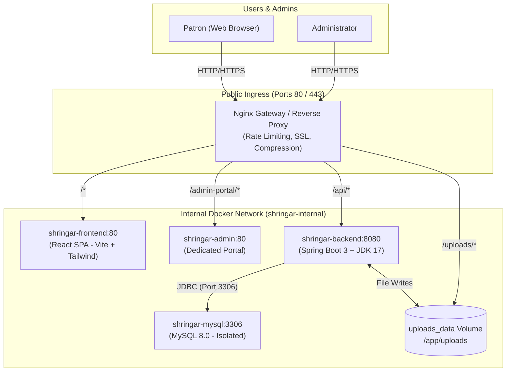
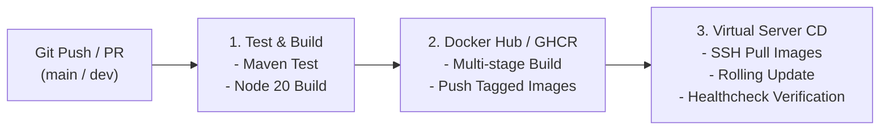

# 🛠️ Shringar Platform — DevOps & Deployment Guide

This guide details the complete DevOps lifecycle for the **Shringar Mehendi Platform**: from local containerization, staging/testing on virtual servers, to zero-downtime production deployment with automated CI/CD.

---

## 🏛️ System Architecture



---

## 🗺️ Step-by-Step DevOps Itinerary

### Phase 1: Containerization & Local Verification
1. **Multi-Stage Dockerfiles**:
   - `shringar-backend/Dockerfile`: Maven 3.9 + Temurin JDK 17 build stage $\rightarrow$ Temurin JRE 17 Alpine runtime with non-root user `shringar`.
   - `shringar-react/Dockerfile`: Node 20 Alpine build stage $\rightarrow$ Nginx Alpine serving optimized production assets.
   - `shringar-admin/Dockerfile`: Lean Nginx Alpine serving admin portal static files.
2. **Local Testing**:
   ```bash
   # Copy environment variables
   cp .env.example .env

   # Spin up full stack locally
   docker compose up --build -d

   # Verify running containers
   docker compose ps

   # Check logs
   docker compose logs -f backend
   ```
3. **Access Local Endpoints**:
   - Customer Website: `http://localhost:3000` or `http://localhost/`
   - Standalone Admin: `http://localhost:5501` or `http://localhost/admin-portal/`
   - Backend Health: `http://localhost:8080/api/settings`

---

### Phase 2: Virtual Server (Staging / Testing) Setup
Deploying to a cloud virtual machine (e.g. Ubuntu 22.04 LTS on AWS EC2, DigitalOcean Droplet, GCP Compute Engine, or Hetzner):

1. **Server Initial Hardening**:
   ```bash
   sudo apt update && sudo apt upgrade -y
   sudo apt install -y curl git ufw fail2ban ca-certificates apt-transport-https

   # Configure Firewall
   sudo ufw default deny incoming
   sudo ufw default allow outgoing
   sudo ufw allow 22/tcp      # SSH
   sudo ufw allow 80/tcp      # HTTP
   sudo ufw allow 443/tcp     # HTTPS
   sudo ufw enable
   ```

2. **Install Docker Engine & Compose v2**:
   ```bash
   curl -fsSL https://get.docker.com -o get-docker.sh
   sudo sh get-docker.sh
   sudo usermod -aG docker $USER
   # Re-login or run: newgrp docker
   docker compose version
   ```

3. **Clone Repository & Configure Environment**:
   ```bash
   sudo mkdir -p /opt/shringar
   sudo chown -R $USER:$USER /opt/shringar
   git clone <YOUR_GIT_REPO_URL> /opt/shringar
   cd /opt/shringar

   cp .env.example .env
   nano .env # Set strong DB passwords, JWT secret, and domain
   ```

4. **Launch Staging Stack**:
   ```bash
   docker compose -f docker-compose.prod.yml up -d
   ```

---

### Phase 3: Automated SSL/TLS (Let's Encrypt / Certbot)
To enable HTTPS on your custom domain (`shringar.in`):

1. **Install Certbot on Host or via Docker**:
   ```bash
   sudo apt install -y certbot
   sudo certbot certonly --standalone -d yourdomain.com -d www.yourdomain.com
   ```
2. **Auto-Renewal Cron**:
   Let's Encrypt certificates renew automatically via systemd timer or cron:
   ```bash
   sudo systemctl status certbot.timer
   ```

---

### Phase 4: CI/CD Pipeline (GitHub Actions)
The repository includes a 3-stage GitHub Actions pipeline at [`.github/workflows/ci-cd.yml`](file:///.github/workflows/ci-cd.yml):



#### Configuring GitHub Repository Secrets:
Go to **Settings $\rightarrow$ Secrets and variables $\rightarrow$ Actions** and add:

| Secret Name | Description | Example Value |
|---|---|---|
| `PROD_SERVER_HOST` | Public IP or DNS of production virtual server | `143.198.x.x` |
| `PROD_SERVER_USER` | SSH username | `ubuntu` or `root` |
| `PROD_SSH_PRIVATE_KEY` | Private SSH Key for passwordless deploy | `-----BEGIN OPENSSH...` |
| `STAGING_SERVER_HOST` | Staging testing server IP | `159.223.x.x` |
| `STAGING_SERVER_USER` | Staging SSH username | `ubuntu` |
| `STAGING_SSH_PRIVATE_KEY`| Staging SSH key | `-----BEGIN OPENSSH...` |

---

### Phase 5: Database Disaster Recovery & Maintenance

1. **Daily Automated Backup**:
   Add this to server crontab (`crontab -e`):
   ```bash
   0 3 * * * /opt/shringar/scripts/backup-db.sh >> /var/log/shringar_backup.log 2>&1
   ```
   *Automatically dumps compressed gzip archives to `/opt/shringar/backups` and prunes backups older than 7 days.*

2. **Restoring a Database Backup**:
   ```bash
   gunzip < /opt/shringar/backups/shringar_db_20261011_030000.sql.gz | docker exec -i shringar-prod-mysql mysql -u root -p"$DB_ROOT_PASSWORD" shringar_db
   ```

---

## ⚡ Quick Operational Commands

| Action | Command |
|---|---|
| **Deploy Update** | `./scripts/deploy.sh` |
| **View Live Logs** | `docker compose -f docker-compose.prod.yml logs -f --tail=100` |
| **Restart Stack** | `docker compose -f docker-compose.prod.yml restart` |
| **Check Container Resources** | `docker stats` |
| **Prune Old Images** | `docker image prune -af` |
| **Check API Health** | `curl -f http://localhost:8080/api/settings` |
